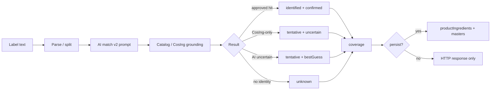

# Local Firestore-backed analysis API

This is the local demo backend for the approved AN-02 rules and AN-03 Python
engine. It reads the shared `products` collection with Firebase Admin, returns
raw product ingredient strings to the app, and evaluates normalized routine
requests posted by the app.

## Setup on the development Mac

From the repository root:

```sh
python3 -m venv .venv
source .venv/bin/activate
python -m pip install -r Backend/requirements.txt
```

Use the authorized local Application Default Credentials described in
`docs/FIRESTORE_SETUP.md`. No credential file belongs in the repository or the
iOS app. The server uses project `aesthelity-2026` and Firestore database
`ogdb` by default; override with `FIREBASE_PROJECT_ID` and
`FIRESTORE_DATABASE_ID` when needed.

Ingredient aliases come from the approved `ingredientAliasCatalogs/active`
document. The API reads it for each analysis and serves it to clients at
`GET /api/v1/ingredient-aliases`. If the document is absent or Firestore is
unavailable, the backend and iOS app use the bundled reviewed catalog. Seed it
with `python3 Backend/seed_ingredient_aliases.py` to preview. Writing requires
`INGREDIENT_ALIAS_EDITOR` and `--apply`; replacing an existing catalog also
requires `--replace`.

## Full ingredient catalog (EU CosIng)

`Backend/data/cosing_ingredients.json.gz` is a snapshot of the full EU CosIng
ingredient inventory (33,642 rows, retrieved 2026-11-15). The API loads it at
startup, so names outside the approved catalog resolve offline too. Approved
catalog matches always win.

```sh
python3 Backend/import_ingredient_catalog.py            # dry run: counts only, no writes
python3 Backend/import_ingredient_catalog.py --fetch    # refresh the snapshot from CosIng
python3 Backend/import_ingredient_catalog.py --source export.csv   # classic CosIng CSV export
INGREDIENT_ALIAS_EDITOR=<team identity> python3 Backend/import_ingredient_catalog.py --apply
```

`--apply` writes `ingredients/{id}`, `ingredientAmbiguousTerms/{termKey}` and,
last, `ingredientCatalogs/reference` in batches of 400. The full import is about
33,600 document writes, which is more than the Firestore free tier's daily write
quota. If the project is on the free tier, split the import with `--limit N` and
continue later with `--start-after <collection/docId>`. The approved
`ingredientAliasCatalogs/active` document is never changed.

## Ingredient resolution (#98)

AI-primary matching for catalog and manually entered products. The approved
alias catalog and EU CosIng snapshot are **validators / grounding sources**,
not a hand-maintained alias-rule list for the model. Prompt and schema live in
`Backend/prompts/ingredient_matching_v2.py` (`PROMPT_VERSION =
ingredient-matching-v2`).

### Flow



### `POST /api/v1/ingredients/resolve`

Same auth as analyses (Firebase ID token). Local demo mode
(`AESTHELITY_DEMO_MODE=1` on loopback) skips token checks.

| Field | Required | Default | Meaning |
| --- | --- | --- | --- |
| `contractVersion` | yes | — | Must be `1` |
| `ingredients` | yes | — | Array of strings (max 200, max 500 chars each) |
| `ai` | no | `true` | AI-primary matching. `false` = deterministic catalog-only |
| `persist` | no | `false` | Write `productIngredients` + master merges |
| `productID` | when `persist` | — | Manual: client `ManualProduct` UUID. Catalog: stable catalog id |
| `sourceType` | when `persist` | `manual` | `manual` (requires `ownerUID` from auth) or `catalog` |
| `format` | no | — | `analysis-input` adds the #99 envelope |
| `listStatus` | with format | derived | `complete` \| `partial` \| `unavailable` |

**listStatus for manual entry.** With rows and no `listStatus`, the default is
`partial` (a scan or paste does not prove the whole label was read), which the
#99 engine reports as incomplete. When the user typed the full ingredient list,
manual entry should send `"listStatus": "complete"`; send `partial` when they
entered only some ingredients.

**Example request**

```json
{
  "contractVersion": 1,
  "ingredients": ["Aqua", "niacinimide", "isobutyl mystery", "blurred txt"],
  "ai": true,
  "persist": true,
  "productID": "A1B2C3D4-E5F6-7890-ABCD-EF1234567890",
  "sourceType": "manual",
  "format": "analysis-input",
  "listStatus": "complete"
}
```

**Example success response** (shape abbreviated)

```json
{
  "contractVersion": 1,
  "status": "ok",
  "coverage": "partial",
  "providerStatus": "ok",
  "promptVersion": "ingredient-matching-v2",
  "model": "nvidia/nemotron-3.5-super-vl:free",
  "ingredients": [
    {
      "index": 0,
      "originalText": "Aqua",
      "status": "identified",
      "mapping": "confirmed",
      "ingredientID": "water",
      "normalizedName": "Water",
      "bestGuess": null
    },
    {
      "index": 1,
      "originalText": "niacinimide",
      "status": "identified",
      "mapping": "confirmed",
      "ingredientID": "niacinamide",
      "normalizedName": "Niacinamide"
    },
    {
      "index": 2,
      "originalText": "isobutyl mystery",
      "status": "tentative",
      "mapping": "uncertain",
      "suggestedID": "4-isobutylresorcinol",
      "bestGuess": "4-ISOBUTYLRESORCINOL"
    },
    {
      "index": 3,
      "originalText": "blurred txt",
      "status": "unknown",
      "mapping": "unmatched",
      "reason": "gibberish"
    }
  ],
  "persisted": {
    "productPath": "productIngredients/A1B2C3D4-E5F6-7890-ABCD-EF1234567890",
    "masterIDs": ["4-isobutylresorcinol", "niacinamide", "unresolved-…", "water"],
    "writeCount": 5
  }
}
```

**AI failure** — HTTP **200**, list preserved, not presented as successful matching:

```json
{
  "contractVersion": 1,
  "status": "failed",
  "failureCode": "provider_unavailable",
  "coverage": "unknown",
  "providerStatus": "provider_unavailable",
  "ingredients": [
    {
      "index": 0,
      "originalText": "Aqua",
      "status": "unknown",
      "mapping": "unmatched",
      "reason": "ai-unavailable",
      "explanation": "ai-unavailable"
    }
  ]
}
```

**Ownership on persist.** Replacing `productIngredients/{productID}` reads the
existing doc in a Firestore transaction first. Another user's manual record →
HTTP **403** (`forbidden`, no write). Catalog vs manual collision on the same
id → HTTP **409** (`conflict`, no write). Same owner + same `sourceType` →
update.

**Request validation** (`contractVersion`, `ai`, `ingredients`, `persist`,
`sourceType`, `productID`, `format`, `listStatus`) runs **before** any AI call
or Firestore write. Invalid `format` → HTTP **400** with zero AI calls and
zero writes.

**Firestore write failure** when `persist: true` — HTTP **503**, rows still in the body:

```json
{
  "contractVersion": 1,
  "status": "failed",
  "failureCode": "firestore_unavailable",
  "coverage": "partial",
  "ingredients": [ "…" ],
  "submittedIngredients": ["Aqua", "niacinimide"],
  "error": { "code": "SERVICE_UNAVAILABLE", "message": "Ingredient data could not be saved." }
}
```

### Status and coverage rules

| Issue `status` | `#98` `mapping` | Meaning |
| --- | --- | --- |
| `identified` | `confirmed` | Grounded in the **approved** catalog (analysis-eligible) |
| `tentative` | `uncertain` | CosIng-only, AI best guess, or ambiguous grounding |
| `unknown` | `unmatched` | No usable identity |

**Coverage** (aligned with #99: only approved hits count):

| `coverage` | Rule |
| --- | --- |
| `complete` | Every row has `mapping == "confirmed"` |
| `partial` | At least one `confirmed` and at least one non-confirmed (e.g. confirmed + CosIng-only) |
| `unknown` | Empty list, or **zero** confirmed rows (CosIng-only alone → `unknown`) |

A row becomes `confirmed` only when the model returns `identified` **and** the
name grounds to an approved catalog ID. AI-stated `tentative` never becomes
`confirmed`, even if `bestGuess` exists in the catalog.

### Firestore layout

Reuse `ingredients/{masterId}` alongside the CosIng import (merge writes; do not
wipe CosIng fields):

| Master ID | When | Notes |
| --- | --- | --- |
| Catalog slug (e.g. `niacinamide`) | Confirmed or CosIng-only | `resolutionStatus: identified`, `encounteredInProducts: true`, `observedTexts` via ArrayUnion |
| `unresolved-<sha256(name_key)[:16]>` | Tentative / unknown without a catalog ID | Same `name_key` → same ID; never merged into a confirmed record |

Product lists (separate from curated `products/`):

| Path | Purpose |
| --- | --- |
| `productIngredients/{productId}` | Ordered `submittedIngredients` + match rows with `masterIngredientID` / `masterRef` |
| Manual docs | `sourceType: manual`, `ownerUID` = authenticated Firebase UID (#108 isolation) |
| Catalog docs | `sourceType: catalog`, `ownerUID: null` |

Spark plan: about `1 + U` writes per product (`U` = distinct master IDs), one
atomic batch. Details also in `docs/FIRESTORE_SCHEMA.md`.

### Feeding the #99 analysis engine

`Backend/analysis_engine_input.py` adapts resolve rows. Mia's engine is not
modified.

| #98 `mapping` | #99 `status` | Names |
| --- | --- | --- |
| `confirmed` | `matched` | `canonicalName` = exact approved name |
| `uncertain` | `uncertain` | `proposedName` = `bestGuess`, else CosIng `canonicalName` / `suggestedID` |
| `unmatched` / `ambiguous` | `unknown` | `reason` only |

```python
from Backend.analysis_engine_input import analysis_product, analysis_normalization, canonical_records

product = analysis_product("serum", resolve_rows, approved_catalog, list_status="complete")
normalization = analysis_normalization([product], catalog_version=approved_catalog["version"])
records = canonical_records(approved_catalog)
```

Over HTTP, add `"format": "analysis-input"` (optional `productID`, `listStatus`).
Default without one: empty → `unavailable`, else `partial`.

**Routine (several products).** `analysis_routine_normalization(payloads)`
merges per-product `analysisInput` envelopes (or whole resolve responses) into
one normalization for `analyze_normalized_routine`. Each product keeps its own
`productID`, `listStatus` and rows; unknown/uncertain rows stay as they are.
The same product twice with identical content is kept once; conflicting
content under one `productID` is rejected. `providerStatus` is `ok` only if
every source was ok. `routineListStatus` is `complete` only if every product
is complete (`unavailable` if all are, else `partial`).

```python
from Backend.analysis_engine_input import analysis_routine_normalization

routine = analysis_routine_normalization([cleanser_response, serum_response])
result = analyze_normalized_routine(routine, routine_context, records, references, provider)
```

### Run locally

```sh
python3 -m venv .venv
source .venv/bin/activate
python -m pip install -r Backend/requirements.txt
# Application Default Credentials: see docs/FIRESTORE_SETUP.md
# Put OPENROUTER_API_KEY in gitignored Backend/.env (never commit or print the value)
AESTHELITY_DEMO_MODE=1 python Backend/analysis_api.py
```

Env var **names** (values stay local): `OPENROUTER_API_KEY`,
`AESTHELITY_NORMALIZATION_MODEL`, `AESTHELITY_NORMALIZATION_FALLBACK_MODEL`,
`OPENROUTER_BASE_URL`, `FIREBASE_PROJECT_ID`, `FIRESTORE_DATABASE_ID`,
`AESTHELITY_DEMO_MODE`, `AESTHELITY_API_HOST`, `AESTHELITY_API_PORT`,
`AESTHELITY_LIVE_AI_TEST`.

```sh
.venv/bin/python -m unittest discover -s tests/backend -p 'test_*.py'
.venv/bin/python -m unittest discover -s tests
```

Live OpenRouter smoke test: `AESTHELITY_LIVE_AI_TEST=1` (skipped otherwise).
Unit tests use a fake AI provider and FakeFirestore — no network and no real
writes.

iOS: `ManualProductEntryView` calls resolve on Review (`ai: true`) and, when
signed in, Save with `persist: true` and `productID` = the `ManualProduct`
UUID. If the API is down, Review falls back to the on-device catalog
normalizer.

## Start the simulator demo

```sh
AESTHELITY_DEMO_MODE=1 python Backend/analysis_api.py
```

The server binds to `127.0.0.1:8765`. The Xcode app target is configured to use
that local address. Demo mode skips Firebase ID-token verification for the
analysis request because the current app has no Firebase sign-in flow. It is
restricted to loopback and must not be exposed or deployed.

The app's Analysis sheet offers four real API scenarios:

- Caution PM: `serum_retinol` and `treatment_exfoliant`.
- No findings AM: cleanser, vitamin C serum, moisturizer, and mineral sunscreen.
- Recorded-allergy example: fragranced mist and a demo allergy to limonene.
- Partial-data example: `mask_partial`.

For each run, the app gets product documents from `GET /api/v1/products`,
loads the current alias catalog from `GET /api/v1/ingredient-aliases`,
normalizes the original ingredient strings deterministically, then posts the
normalized product objects to `POST /api/v1/analyses`. The server verifies the
catalog version through the active catalog and returns findings for display.
Scenarios are labeled demo data; they are not a saved personal routine or
profile.

## Routes

- `GET /health`: API, rule, catalog, and Firestore database identifiers.
- `GET /api/v1/ingredient-aliases`: current approved alias catalog for deterministic client normalization.
- `POST /api/v1/ingredients/resolve`: AI-primary ingredient matching (#98). See **Ingredient resolution (#98)** above for request/response, coverage, persist, and failure shapes. Requires the same auth as analyses.
- `GET /api/v1/ingredients/{ingredientID}`: one full-catalog ingredient (CAS, functions, CosIng sources).
- `GET /api/v1/products`: shared catalog records in API camelCase.
- `GET /api/v1/products/{productID}`: one shared product.
- `POST /api/v1/analyses`: evaluate one normalized AM or PM routine.

Outside local demo mode, analysis requests require a valid Firebase ID token.
Production hosting, app sign-in, and user-specific data access need deployment
configuration and security review.
